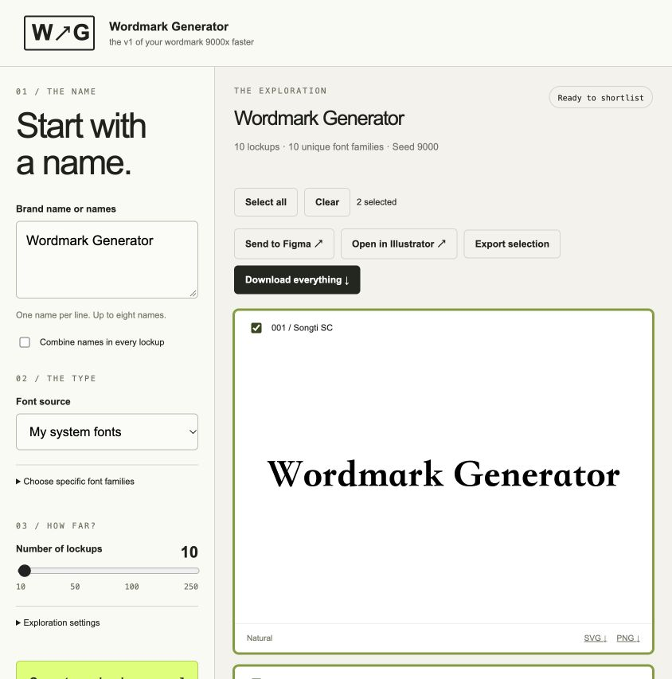

# Wordmark Generator

**the v1 of your wordmark 9000x faster**

A local font exploration lab. Enter a brand name—or combine multiple names—and generate **10, 50, 100, or 250 wordmark lockups** from your system fonts or a directory of fonts. Browse, shortlist, and hand off vector outlines to your design tools.

- Local web app with drag-and-drop font files and folders
- Installed fonts, recursive font-directory discovery, and optional family selection
- One name, alternative names, or multiple names stacked in every lockup
- Standalone HTML preview, individual outlined SVGs, 1200 × 800 PNGs, rendered contact sheets, font index, and ZIP
- Figma SVG handoff plus an optional local import plugin; open selections in Illustrator
- CLI, JSON input/output, local HTTP API, stdio MCP, and a portable agent skill
- Reproducible shuffle seeds and family exclusions for continuing an exploration
- A manually triggered GitHub Actions workflow that produces downloadable exports



## Run locally

**Requires macOS, Node.js 22+, and Xcode Command Line Tools (Swift).** Rendering uses Apple CoreText and CoreGraphics. Windows and Linux rendering are not supported in v1. No npm dependencies, API keys, cloud accounts, or font installation are required.

```sh
git clone https://github.com/AlexBloom/wordmark-generator.git
cd wordmark-generator
npm ci
npm start
```

Open **http://127.0.0.1:9000**. The first generation compiles the Swift engine; later runs reuse the compiled binary. Install Apple’s tools with `xcode-select --install` if Swift is missing.

1. Enter one name per line. Switch on **Combine names** to use all names in every lockup; otherwise the generator alternates between names.
2. Use your system fonts, enter a local directory path, or drop font files/a folder. Supported containers: TTF, OTF, TTC, OTC, DFONT. Old resource-only Type 1/suitcase files need conversion first.
3. Set 10, 50, 100, or 250, then generate.
4. Select your favorites, export a combined SVG, or download everything. Each card also has individual SVG and PNG downloads.

The app binds to `127.0.0.1` and rejects foreign browser origins. Fonts and generated files stay local. The server keeps results under `.wordmark/outputs/` and uploads under `.wordmark/uploads/`. Delete those folders yourself when no longer needed. Generation jobs are tracked for the current app session; downloaded HTML previews work offline.

## Command line

```sh
node bin/wordmark.mjs generate --name "Acme" --count 50 --out ./output/acme
node bin/wordmark.mjs generate --name "Acme" --name "Studio" --combine --count 100 --font-dir "/path/to/fonts" --out ./output/acme-studio
node bin/wordmark.mjs fonts --name "Acme" --font-dir "/path/to/fonts"
node bin/wordmark.mjs generate --request request.json --out ./output/new-exploration
node bin/wordmark.mjs serve --port 9100
```

The output directory must be new: previous results are never overwritten. Success writes JSON to stdout; errors use stderr and a nonzero exit code. `--stdin` accepts a JSON request on stdin.

```json
{
  "names": ["Acme", "Studio"],
  "combine": true,
  "count": 50,
  "seed": 9000,
  "fontDirectory": "/path/to/fonts",
  "excludeFamilies": []
}
```

Omit `fontDirectory` to use installed system fonts. `fontFiles` accepts explicit paths; `fonts` accepts IDs from font discovery. Names preserve spelling and case. Discovery checks glyph coverage and picks one face per family. If fewer families are available than requested lockups, the generator reuses families with different treatments; the manifest reports `uniqueFamilies`. A quantity is a count of lockups, **not a promise of that many unique fonts**. Seeds reproduce a run with the same font inventory and platform; other machines may render differently.

## Use as an agent skill

```sh
npm run install:skill
```

This installs a self-contained skill and runtime into `~/.codex/skills/wordmark-generator` (or `$CODEX_HOME/skills/wordmark-generator`). Existing installations are never overwritten. Restart or refresh your agent’s skill list, then invoke **`$wordmark-generator`**. To install for another agent that supports `SKILL.md` folders:

```sh
node scripts/install-skill.mjs /path/to/your/agent/skills/wordmark-generator
```

The same skill is available in `skills/wordmark-generator/`. Its bundled launcher works in the repository or in the installed skill. No dependence on this chat or a specific user’s folders.

## Agent interoperability

Every entry point calls the same renderer and accepts the same request shape. See [the agent API](docs/AGENT_API.md) for JSON Schema, HTTP, MCP, and result contracts. See [AGENTS.md](AGENTS.md) for contributor instructions.

MCP client configuration (replace the path with your actual clone path):

```json
{
  "mcpServers": {
    "wordmark-generator": {
      "command": "node",
      "args": ["/absolute/path/to/wordmark-generator/bin/wordmark.mjs", "mcp"]
    }
  }
}
```

The server exposes `generate_wordmarks` and `list_fonts` over newline-delimited stdio JSON-RPC using the MCP `2024-11-05` initialization protocol. It does not configure an agent or grant permissions automatically. CLI/JSON and the HTTP API remain usable without MCP.

## Figma and Illustrator

**Figma:** Select lockups and click **Send to Figma**. Download the selection SVG and drag it onto a Figma canvas. Copy SVG is also available; some design apps paste markup as text, so file import is the reliable route. This does not silently modify a remote Figma file.

For importing multiple individual SVGs, use the optional development plugin:

1. In Figma desktop, create a new development plugin to obtain your own Figma-assigned plugin ID.
2. Run `node scripts/configure-figma.mjs YOUR_PLUGIN_ID`.
3. Import the generated `figma-plugin/manifest.local.json` as a development plugin.
4. Run **Wordmark Generator** in a design file and choose exported SVGs. The plugin imports vector paths and zooms to the results. It makes no network requests.

**Illustrator:** Select lockups and click **Open in Illustrator**. The local server opens the SVG selection sheet with the installed Adobe Illustrator app. If Illustrator is missing or registered under another name, download the SVG and open it manually. Outputs are SVG files, not native `.ai` documents. Original fonts are not needed to view outlined artwork.

## GitHub workflow

In **Actions → wordmark generator → Run workflow**, enter a JSON array of names, choose a quantity, and optionally combine names. The macOS runner generates the lockups and uploads a seven-day artifact with the HTML, SVGs, PNGs, boards, and ZIP. It does not deploy a website.

Hosted runners have **their own system font inventory**, not your Mac’s fonts. For custom fonts, supply a repository-relative directory only if your font license permits storing and processing those fonts there. No fonts are included in this repository.

## Font licensing

**Users are responsible for their own font licensing.** Having a font installed, dropping a font into the app, or converting lettering to outlines does not grant a license or change its restrictions. Check the applicable terms for commercial use, logo creation, sharing, embedding, redistribution, and CI/cloud processing. Export archives do not contain source font files. The MIT license covers this software, not third-party fonts.

## Development

```sh
npm run build   # Compile the Swift renderer
npm run check   # Check JavaScript syntax
npm test        # Exercise all four scales, exports, uploads, HTTP and MCP
npm run dev     # Local web app
```

`engine/` renders typography and boards; `lib/` contains the shared runtime, HTTP and MCP entry points; `web/` is the local GUI; `skills/` contains the portable skill; `figma-plugin/` is the optional importer. `dev` is the development branch; `main` is protected and updated through a pull request. No production hosting is configured.
